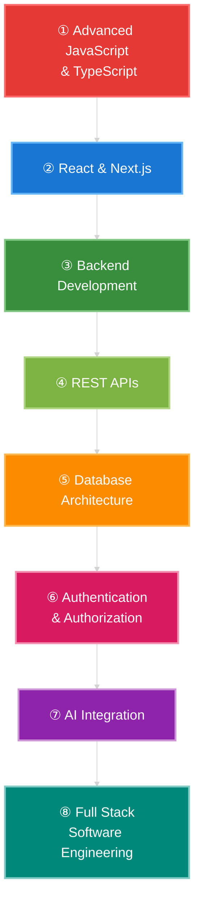

# Hi, I'm Piel Mitra 👋

### Full Stack Developer | AI-Driven Full Stack Web Engineering

Building modern, responsive, and user-focused web applications with clean code, practical solutions, and continuous learning.

---

## 👨‍💻 About Me

### Hi, I'm Piel Mitra 👋
**Full Stack Developer | Building for the Web, Exploring AI 🤖**

*Turning ideas into elegant, scalable, and user-focused digital experiences.*

I'm a passionate **Full Stack Web Developer** who enjoys building modern web applications, solving real-world problems, and transforming ideas into functional digital products.

- 🚀 **Development:** Building responsive and interactive applications with React and Next.js.
- 💻 **Tech Stack:** Working with JavaScript, TypeScript, Tailwind CSS, Node.js, and modern web technologies.
- 🤖 **AI & Innovation:** Exploring AI-powered features and intelligent web experiences.
- 🧩 **Problem Solving:** Writing clean, maintainable code and continuously improving development practices.
- 📚 **Continuous Learning:** Strengthening my skills through hands-on projects and practical experimentation.
- 🎯 **My Goal:** To become a skilled Software Engineer and build impactful, production-ready applications.

**Code with Purpose • Learn Every Day • Build Something Great**

## 🛠️ Skills in Technologies

### Languages

  

### CSS Frameworks & Libraries

  

### JavaScript Frameworks & Libraries

  

### Database & ORM

  

### Deployment Platforms

  

### Design & Graphics

  

### Tools & Technologies

  

---

## 📊 GitHub Statistics

 

 

---

## 🎯 Current Focus

I'm focusing on strengthening my full-stack development skills and building production-ready applications.

- ⚡ Advanced JavaScript and TypeScript
- ⚛️ React and Next.js
- 🔧 Backend development and REST APIs
- 🗄️ Database architecture and optimization
- 🔐 Authentication and authorization
- 🤖 AI integration in web applications
- 🏗️ Clean architecture and scalable software design

## 📚 LEARNING PATH

My roadmap toward becoming a professional Full Stack Software Engineer.

### 🚀 LEARN • BUILD • IMPROVE • INNOVATE

## 💡 Development Philosophy

### Build • Learn • Improve • Repeat

I believe consistent practice, real-world problem-solving, and continuous learning are the foundations of becoming a better developer.

---

## 🌱 Learning & Goals

- 📚 Strengthen advanced TypeScript skills
- ⚛️ Build scalable applications with React and Next.js
- 🔧 Improve backend development skills
- 🗄️ Learn database architecture and optimization
- 🔐 Understand authentication and authorization
- 🤖 Explore AI integration in web applications
- 🏗️ Learn clean architecture and scalable software design
- 🚀 Build production-ready full-stack applications

---

## 🤝 Connect With Me

---

🚀 **Build • Learn • Grow**

Thanks for visiting my GitHub profile!

⭐ Feel free to explore my repositories and follow my development journey.

